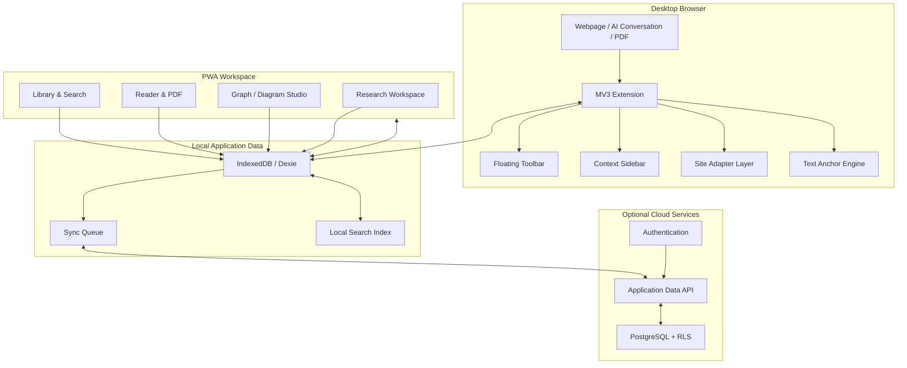

# 03 — System Architecture

## 3.1 Architecture overview

UKW uses a **local-first, modular architecture**.



## 3.2 Application surfaces

### A. Browser extension
Responsibilities:
- Detect supported page context.
- Capture user selection.
- Display floating toolbar.
- Render and remove annotation overlays.
- Host contextual sidebar.
- Communicate with background/service worker.
- Avoid taking ownership of the webpage's application state.

### B. PWA
Responsibilities:
- Library and universal search.
- Note and bookmark management.
- Graph and diagram editing.
- Research projects and references.
- PDF and captured-content reading.
- Account, sync, backup, and settings.

### C. Shared domain core
Keep reusable types and business rules in shared modules:
- Annotation types.
- Anchor model.
- Graph model.
- Source model.
- Validation.
- Serialization.
- Sync conflict rules.
- Permissions and capability checks.

### D. Cloud
Responsibilities:
- Authentication.
- Cross-device persistence.
- Row-level access control.
- Optional backup and synchronization.
- No privileged secret in browser code.

## 3.3 Suggested repository structure

```text
universal-knowledge-workspace/
├── apps/
│   ├── extension/
│   │   ├── public/
│   │   └── src/
│   │       ├── background/
│   │       ├── content/
│   │       ├── popup/
│   │       ├── sidebar/
│   │       ├── adapters/
│   │       └── manifest/
│   └── pwa/
│       └── src/
│           ├── app/
│           ├── pages/
│           ├── components/
│           ├── features/
│           └── service-worker/
├── packages/
│   ├── domain/
│   ├── database/
│   ├── anchor-engine/
│   ├── graph-engine/
│   ├── sync-engine/
│   ├── ui/
│   └── config/
├── docs/
├── tests/
├── scripts/
├── package.json
└── README.md
```

A monorepo is recommended once both extension and PWA exist. For a very early prototype, a simpler structure is acceptable.

## 3.4 Extension message flow

1. Content script detects a user selection.
2. Content script validates that the selection is eligible.
3. Toolbar receives selection metadata.
4. User chooses an action.
5. Content script sends a typed message to the extension background worker.
6. Background worker validates the message and writes to the local data layer.
7. UI receives a success/failure response.
8. Sidebar updates from the saved record.

Never trust arbitrary webpage messages as authenticated application commands.

## 3.5 Site adapter architecture

Create a generic adapter interface and separate adapters for supported platforms.

Adapter responsibilities:
- Detect whether the current page is supported.
- Extract stable source identity.
- Extract thread or document identity when available.
- Identify message containers where possible.
- Avoid platform-specific selectors inside the annotation core.
- Report capability and confidence.

Adapters should fail safely when page structure changes.

## 3.6 Rendering strategy

Prefer non-destructive rendering:
- Use the CSS Custom Highlight API where browser support is adequate.
- Use carefully managed overlay elements only when necessary.
- Avoid replacing the page's text nodes.
- Keep extension UI in an isolated Shadow DOM root where practical.
- Track and clean up observers.
- Do not repeatedly scan the entire DOM on every mutation.

## 3.7 Storage architecture

- IndexedDB is the source of truth for local user edits.
- Cloud is a synchronization target, not a prerequisite for saving.
- Every record has a stable ID and timestamps.
- Sync changes are tracked with an outbox/queue.
- Search indexes can be rebuilt from canonical records.
- Export format must be versioned.

## 3.8 Graph architecture

Store nodes, edges, viewport, and layout metadata separately or as validated structured records. Do not store a graph only as a screenshot.

Graph nodes may reference:
- Source/document
- Annotation
- Note
- Research project
- Another graph node

## 3.9 Scaling strategy

Initial:
- Local database.
- Small, indexed queries.
- Simple sync queue.
- Static PWA hosting.

Later:
- Pagination and virtualized views.
- Background sync batching.
- Database indexes based on actual query patterns.
- Migration tooling.
- Observability for errors and sync failures.

## 3.10 Architecture constraints

- No AI API in the initial product.
- No mandatory paid backend.
- No service-role key in client code.
- No assumption that every site exposes stable message IDs.
- No promise of overlay support over arbitrary native mobile apps.
