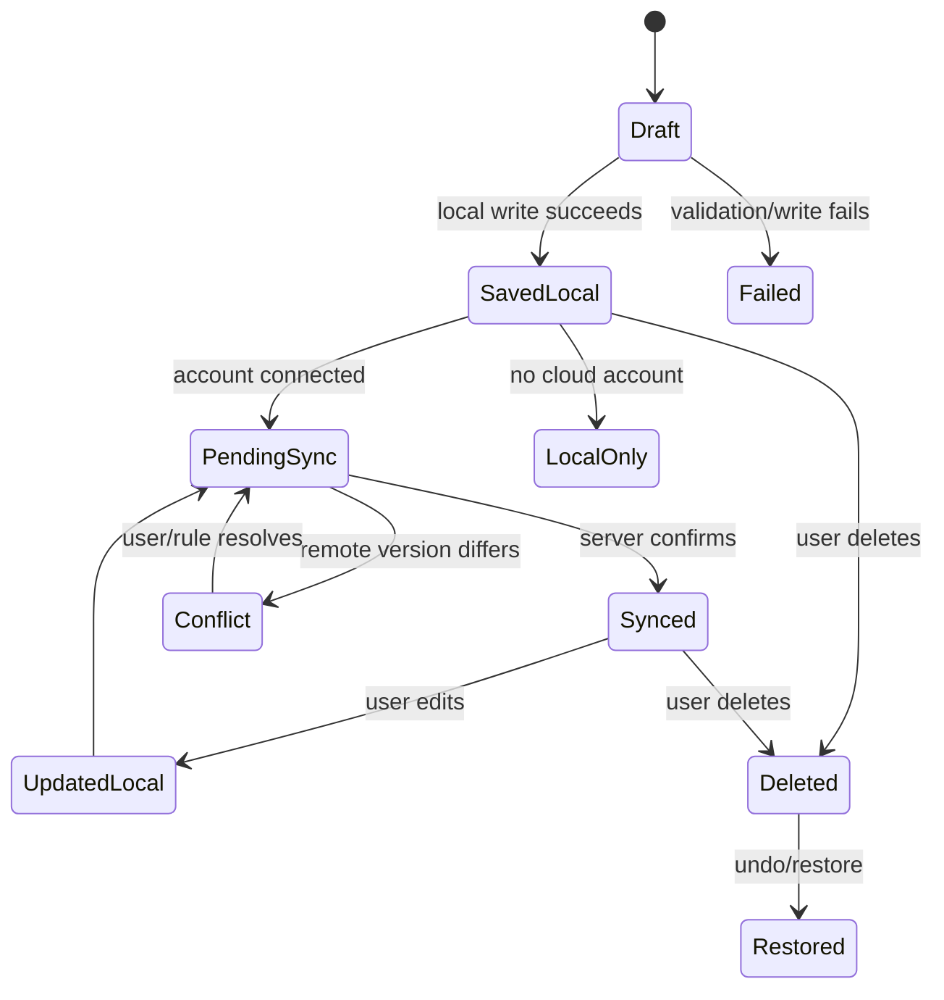

# 07 — Core Business Logic

## 7.1 Annotation lifecycle

## 7.2 Text anchor capture

When a user selects text:
1. Read the selected string.
2. Normalize whitespace for matching while preserving the original quote.
3. Capture a short prefix and suffix.
4. Capture offsets relative to a stable text representation when feasible.
5. Capture a DOM path or selector only as a fallback.
6. Capture source URL and page identity.
7. Capture platform-specific thread/message IDs only when available.
8. Store a text fingerprint.
9. Save the anchor with a confidence/status field.

Never assume a CSS selector is a permanent identifier.

## 7.3 Anchor restoration order

Recommended restoration sequence:
1. Validate canonical URL and source identity.
2. Search for exact quote matches.
3. Score matches using prefix and suffix context.
4. Use offsets if the underlying text fingerprint still matches.
5. Use platform message identity if adapter can verify it.
6. Use DOM path as a low-confidence fallback.
7. If multiple candidates remain, ask the user to choose.
8. If no safe candidate exists, mark annotation as `orphaned`.

Do not attach a highlight to a merely similar paragraph without clear confidence.

## 7.4 Confidence scoring

A simple initial scoring model may combine:
- Exact quote match.
- Prefix match.
- Suffix match.
- Same message container.
- Same text fingerprint.
- Same document identity.

Store the score and matched strategy for diagnostics. Thresholds must be calibrated with real test pages; do not treat example thresholds as universal truth.

## 7.5 URL identity

Store:
- Original URL.
- Normalized URL.
- Hostname.
- Path.
- Relevant stable query parameters.
- Platform identifier.
- External thread/document ID where available.

Remove tracking parameters only through a tested allowlist. Do not strip query parameters that identify a conversation or document.

## 7.6 Graph operations

- Node creation generates a stable ID.
- Edge creation validates both endpoint nodes exist in the same graph.
- Deleting a node must define whether connected edges are deleted or retained as broken references; default: delete connected edges in the same transaction.
- Moving a node updates position only.
- Source-linked nodes keep a stable reference to the canonical source record.
- Graph export includes nodes, edges, viewport, and schema version.
- Import validates IDs and repairs or reports invalid references.

## 7.7 Autosave

Recommended behaviour:
- Update local state immediately.
- Debounce rich-text writes briefly to avoid excessive writes.
- Show `Saving`, `Saved locally`, `Sync pending`, `Synced`, or `Error`.
- Never show `Synced` before server confirmation.
- On navigation, flush pending local writes.
- If a write fails, retain the draft in memory and show a recoverable error.

## 7.8 Sync engine

1. Local transaction commits.
2. An outbox item is created in the same transaction.
3. Sync worker batches eligible outbox items.
4. Server validates user identity and payload.
5. Server upserts or records version conflict.
6. Client marks queue item complete only after confirmation.
7. Remote changes are merged into local storage.
8. Search indexes refresh.

### Conflict strategy
- Use `updatedAt`, revision/version, and operation IDs.
- Do not use last-write-wins blindly for graph structures.
- Notes may use a clear last-write-wins policy initially, with conflict copy for simultaneous edits.
- Graph node/edge changes should be tracked at entity level where practical.
- Deletions require tombstones to prevent deleted records reappearing.

## 7.9 Search logic

- Index title, note text, annotation quote, tags, source title, and graph node labels.
- Search locally first.
- Filter after text match using indexed fields.
- Provide exact phrase matching where possible.
- Rebuild search index from canonical data after migration or corruption.

## 7.10 Reading progress

Store a stable progress representation:
- Document ID.
- Heading/section identifier where available.
- Scroll ratio.
- Text anchor near reading position.
- Updated timestamp.

Scroll ratio alone is not reliable when content length changes.

## 7.11 Privacy logic

- Do not collect webpage text beyond what the user explicitly saves, unless an explicit capture mode is enabled.
- Keep private notes private by default.
- Never expose another user's records through search or guessed IDs.
- Clear local account data only after an explicit sign-out/delete choice and explain the effect.
